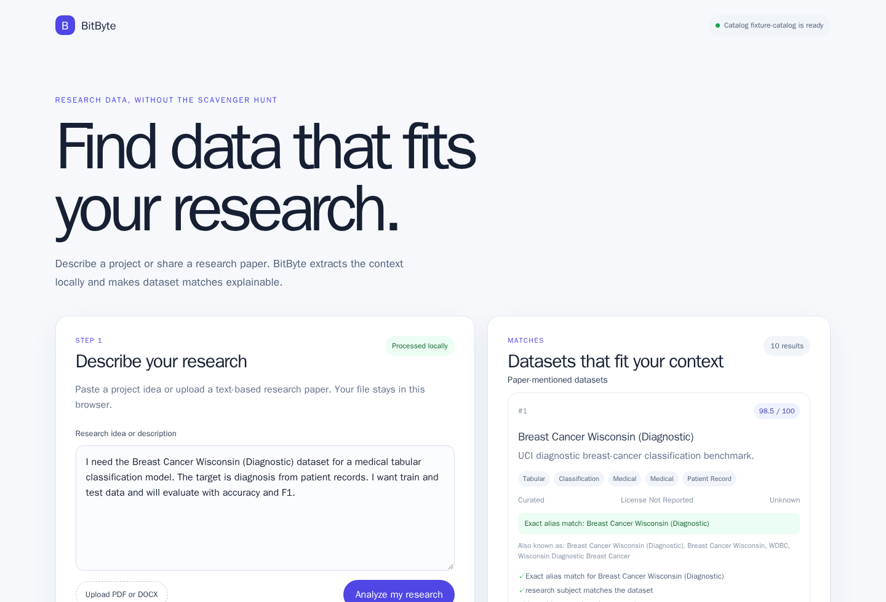
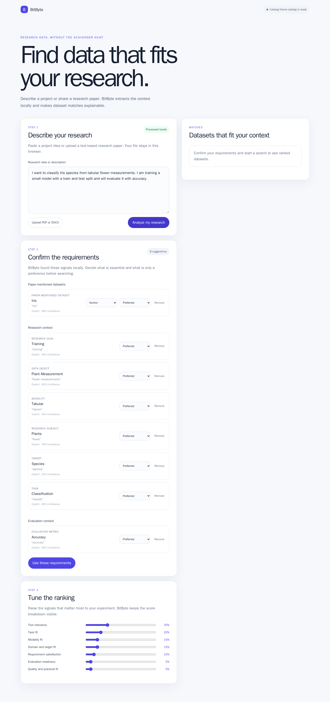
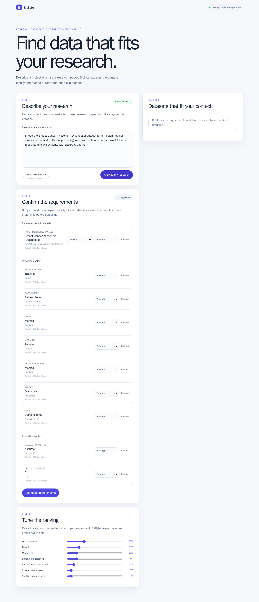
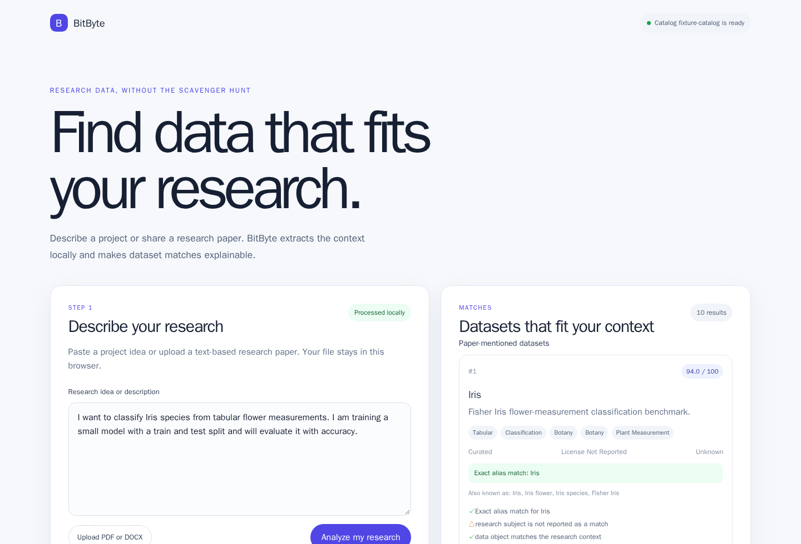
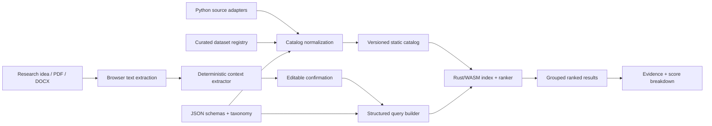

<p align="center">
  
</p>

<p align="center">
  <strong>Privacy-first, explainable dataset discovery for research.</strong><br />
  Turn a research idea or paper into structured context, then find datasets that actually fit it.
</p>

<p align="center">
  <a href="https://mynkz3.github.io/BitByte/">Live demo</a>
  ·
  <a href="#quick-demo">Quick demo</a>
  ·
  <a href="#architecture">Architecture</a>
  ·
  <a href="#run-locally">Run locally</a>
</p>

<p align="center">
  <a href="https://github.com/mynkz3/BitByte/actions/workflows/deploy.yml"></a>
  <a href="https://mynkz3.github.io/BitByte/"></a>
  
  
  
</p>

<p align="center">
  
</p>

> **The short version:** BitByte keeps the research text in the browser, extracts named datasets and research context deterministically, and ranks local catalog records with visible evidence instead of opaque keyword similarity.

## Why BitByte?

Dataset search is usually a scavenger hunt: search engines over-index generic words,
catalog metadata is inconsistent, and a paper's actual context gets lost between a
paragraph and a search box. BitByte is designed around the researcher's intent:

| What the researcher says | What BitByte preserves |
| --- | --- |
| “Use the Breast Cancer Wisconsin dataset for diagnosis.” | Named dataset identity, alias, target, medical subject, patient-record object |
| “Classify Iris species from flower measurements.” | Exact `Iris` identity, tabular modality, classification task, species target |
| “Evaluate ESOL and BACE with a GNN using MAE.” | Dataset roles, chemistry context, model/framework context, evaluation metrics |

### The experience in one sentence

**Describe → confirm → search → understand why.**

The confirmation step is intentional: inferred context stays editable, low-confidence
signals do not silently become hard filters, and every result can explain its match.

## Quick demo

### 1. Paste a research context

Try either of these directly in the [live demo](https://mynkz3.github.io/BitByte/):

<details open>
<summary><strong>Breast Cancer Wisconsin — clinical tabular classification</strong></summary>

```text
I need the Breast Cancer Wisconsin (Diagnostic) dataset for a medical tabular
classification model. The target is diagnosis from patient records. I want
train and test data and will evaluate with accuracy and F1.
```

</details>

<details>
<summary><strong>Iris — flower measurements and species</strong></summary>

```text
I want to classify Iris species from tabular flower measurements. I am training
a small model with a train and test split and will evaluate it with accuracy.
```

</details>

### 2. Confirm the extracted context

BitByte separates paper-mentioned datasets, research context, experiment context,
and evaluation context. Each item shows its evidence and confidence before it is
used for retrieval.

<p align="center">
  
</p>

<details>
<summary><strong>Open the full Breast Cancer confirmation view</strong></summary>

<p align="center">
  
</p>

</details>

### 3. Inspect explainable matches

The first result is not just “similar.” It shows the exact identity/alias match,
the structured fields that agree, and the score components that contributed to the
ranking.

<table>
  <tr>
    <td width="50%"></td>
    <td width="50%"></td>
  </tr>
  <tr>
    <td align="center"><strong>Breast Cancer Wisconsin</strong><br />Exact alias + medical/tabular context</td>
    <td align="center"><strong>Iris</strong><br />Exact alias + flower-measurement context</td>
  </tr>
</table>

<details>
<summary><strong>What the result cards explain</strong></summary>

- exact dataset identity or registered alias;
- subject, data-object, modality, task, and target compatibility;
- framework/model context that was noticed but not allowed to dominate;
- evaluation metrics that remain evaluation context;
- unknown or unverified metadata;
- practical and quality signals from the catalog.

</details>

## Architecture

BitByte is a static application with a local retrieval engine. The browser never
needs a runtime API server to understand the research text or rank the catalog.



### Retrieval pipeline

1. **Extract locally.** Boundary-aware deterministic rules find named datasets,
   aliases, subjects, data objects, tasks, targets, modalities, frameworks,
   models, goals, and metrics.
2. **Keep the evidence.** Suggestions retain the original evidence span,
   confidence, source classification, and optional dataset role.
3. **Let the researcher correct it.** `anchor`, `comparison`, and `context_only`
   roles are explicit controls for named datasets.
4. **Rank in layers.** Exact paper-mentioned identity comes before structured
   research fit, practical quality, and low-weight lexical fallback.
5. **Explain the result.** The WASM bridge transports the score components and the
   browser presents them as readable evidence.

### Ranking precedence

```text
anchor identity match
        ↓
comparison identity match
        ↓
subject + data object + task + target/modality fit
        ↓
constraints + evaluation readiness + quality/practical fit
        ↓
controlled lexical similarity
```

Repeated words such as `graph`, `framework`, `MAE`, and `RMSE` cannot overpower a
strong named-dataset or structured-context match. Metrics and framework names are
shown as context; they are not accidentally treated as dataset identity.

## What is in the catalog?

The checked-in fixture catalog makes the demo reproducible while the scheduled
workflow can refresh broader source metadata.

| Catalog layer | Coverage | Purpose |
| --- | --- | --- |
| Curated registry | ESOL, BACE, Lipophilicity, BBBP, Tox21, ClinTox, HIV, SIDER, QM7–QM9 | Stable names, aliases, subject/object/task metadata |
| Curated tabular examples | Breast Cancer Wisconsin (Diagnostic), Iris | Clear end-to-end classification examples |
| General source adapters | Hugging Face Datasets, OpenML, UCI | Broader discovery and source provenance |
| Static artifacts | Versioned JSON + generated browser index | Offline-friendly loading and deterministic ranking |

General sources are capped at 500 records per source. Curated identities are
published outside that cap so a benchmark name does not disappear because of
source ordering.

## Privacy by design

- Research text stays in the browser during extraction and search.
- Ranking runs in Rust compiled to WebAssembly.
- The runtime app has no database, GPU, paid API, or required backend.
- Catalog refresh happens at build time, not while a researcher is searching.
- PDF and DOCX handling is local; the app does not upload the document for NLP.
- A browser cache can retain the last known-good static catalog when a refresh is
  unavailable.

## Project structure

| Directory | Responsibility |
| --- | --- |
| [`web/`](web/) | React/Vite application, confirmation UI, result cards, local catalog loading |
| [`engine/`](engine/) | Rust extraction, text index, layered ranking, WASM bridge |
| [`indexer/`](indexer/) | Build-time validation and catalog index packaging |
| [`catalog_builder/`](catalog_builder/) | Python adapters, normalization, registry materialization, reports |
| [`schema/`](schema/) | Dataset, query, registry, manifest, and taxonomy contracts |
| [`scripts/`](scripts/) | Catalog refresh and README screenshot helpers |
| [`docs/assets/`](docs/assets/) | Logo and reproducible submission screenshots |

## Run locally

### Prerequisites

- Node.js 22+
- Rust stable with `wasm32-unknown-unknown`
- [`wasm-pack`](https://rustwasm.github.io/wasm-pack/installer/)
- Python 3.12+

### Start the app

```bash
npm install
python -m pip install -e "catalog_builder[test]"
npm run dev
```

Open <http://localhost:5173/BitByte/>.

The development command builds the Rust/WASM package before starting Vite. The
application loads the checked-in fixture catalog from
[`web/public/catalog/`](web/public/catalog/).

### Refresh catalog metadata

```bash
# PowerShell
./scripts/build-catalog.ps1 -Limit 500

# Bash
./scripts/build-catalog.sh
```

Live refreshes preserve the last-known-good source snapshot and mark stale
sources in the generated manifest instead of publishing a silently incomplete
catalog.

### Rebuild the README screenshots

With the dev server running:

```bash
node scripts/capture-readme-screenshots.mjs
```

The script exercises the Breast Cancer Wisconsin and Iris flows and writes the
images to [`docs/assets/screenshots/`](docs/assets/screenshots/).

## Verification

Run the project checks before submitting:

```bash
# Catalog builder
PYTHONPATH="catalog_builder/src" python -m pytest catalog_builder/tests -q

# Rust engine and indexer
cargo fmt --all -- --check
cargo clippy --workspace --all-targets -- -D warnings
cargo test --workspace

# Browser application
npm run typecheck
npm test -- --run
npm run build
npm run test:e2e
```

The regression suite covers:

- named-dataset aliases and exact identity precedence;
- negated and comparative language;
- chemistry, medical, and flower-measurement context;
- anchor/comparison/context-only roles;
- isolation of framework and metric context;
- 13-value WASM score transport;
- catalog registry materialization and schema validation;
- grouped confirmation and result views;
- the original natural-language flow plus Breast Cancer and Iris browser flows.

## Deployment

GitHub Actions builds the static catalog, validates it, builds the React/WASM
application, and publishes the result to GitHub Pages.

- **Live application:** <https://mynkz3.github.io/BitByte/>
- **Catalog workflow:** [`.github/workflows/catalog.yml`](.github/workflows/catalog.yml)
- **Deployment workflow:** [`.github/workflows/deploy.yml`](.github/workflows/deploy.yml)

No runtime API server is required for the deployed app.

## Current boundaries

BitByte intentionally starts with deterministic, explainable extraction. It does
not claim to understand every paraphrase, crawl arbitrary dataset sites at
runtime, or send research documents to an external LLM. Those constraints keep
the first version private, portable, testable, and defensible in a research
submission.

## Provenance

Dataset metadata remains attributed to its source or curated registry entry. Each
published record carries source URLs, aliases, evidence, quality fields, and
provenance in the catalog JSON.
